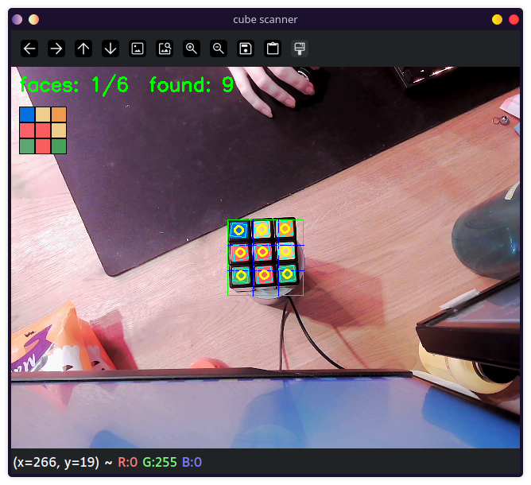
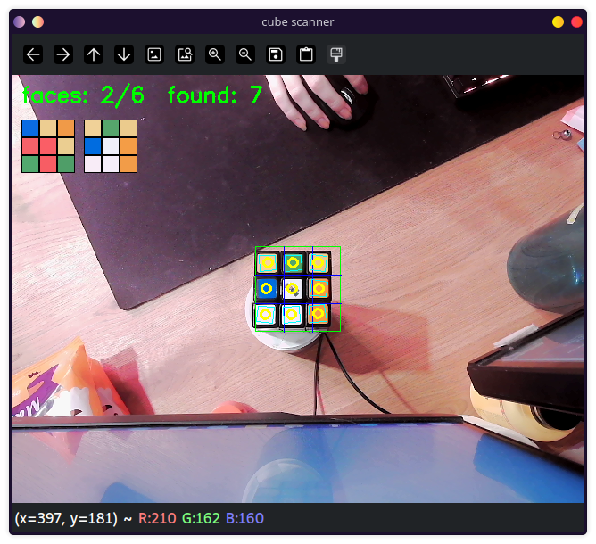
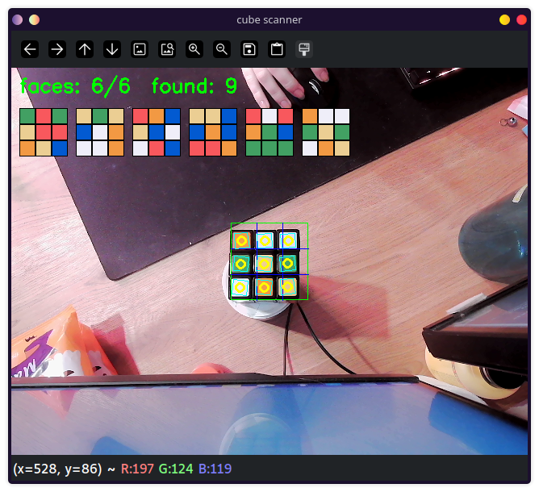

# Rubik's cube scanner
This program reads the colors of a rubiks cube and saves them per side (6 sides). The program was build and tested for a 3x3 cube,
The program is made modular so that similar 3x3 cubes should be able to make use of it, this has not been tested however.
This project is a first step in a rubik solver, which makes use of a ready made library, that however is outside the scope of this version.




## Demo
The demo video shows all 6 sides being found (using a salt shaker as a base). The vidoe also shows how it does not account for rotation and the usage of 'r' to reset the most recent face. Similar tests also work when the cube is held, the salt shaker is mainly used for convenience, as opposed to holding the cube in place.
[demo video](docs/demo.webm)

## How to use
This project was developed on visual studio code, hence terminal usage for running was not required. Below are the commands to run through terminal.

```bash
cmake -S . -B build
cmake --build build
./build/rubiks_scanner
```
| Key | Action |
|---|---|
| `q` | Close the program |
| `r` | Reset most recent face|
| `p` | Print details to terminal (for testing) |

## Requirements
These are the software used to create, run and test the program, other versions may also work, but that has not been tested.

|software|version|
|---|---|
|openCV| 4.13.0|
|Compiler| GCC 16.2.1|
|C++ standard| C++ 20|
|CMake| 4.3.0|
|Build tool| Ninja 1.13.2|
|OS| Fedora KDE linux 44|
|Webcam| 640x480|

## How it works
[pipeline.md](docs/pipeline.md)

The program takes a webcam video capture and, through various steps, returns the colors of each sticker per face to the user. A more detailed pipeline is available in pipeline.md. For more information per step, the explanation below can be read.

### 1. Acquisition
A live view of the webcam is used. 2 checks are ran alongside, first one to check whether the webcam was opened, and a second to check whether the webcam shows something.


### 2. Enhancement
The second step is enhancement. The input image is taken and converted into lab, after which the L channel is split from it and uysed for CLAHE. This is done in order to get sharper rims for finding squares. The exact parameters were chosen through testing with a trackbar.

CLAHE brightens each region differently, hence why it isnt used for colors.
### 3. Segmentation
The segmentation step is used to separate the squares from the rest, and then to separate the stickers (the 3x3) from the rest of the visible squares.
First contours are separated, RETR_CCOMP gives contours a parent, any contour that does not have a parent is skipped.
approxPolyDP simplifies outlines to its fewest corners. Lastly, a check is done for the number of corners, convexity of the lines, total size and the squareness of each square (width/height similarity)

find_sticker_centers is used to keep 1 sticker per cell of the grid. First the 4 points of the square are summed to get an approximate center. A calculation is then performed to number each square center inside the grid per cell. known is also output, where true means it inferred or detected.
The distance between each neighboring center is then used to calculate the positions of missing squares.




### 4. Feature extraction
the read_color function is used for extracting features. First, 4 patches "corners" of each center are found. This is done to get the color of each sticker, including one with a logo (the white center).
The 2 corners with the most similar color are kept, as the logo consists of various color and runs diagonally through 2 of the corner. Hence the other 2 are more similar and thus kept.

This gives the color of each cell.

### 5. Classification
Blob matching is used in main. It checks whether >= 8 stickers were detected, and if they have moved less than 0.2 of a cell since the last frame, if this remains true for 10 frames, it saves the results. Values are sensible defaults, not tuned. 
If the center color is within 25 of a saved center color it replaces the old one (rescanning), if >25, it creates a new face.
After all 6 faces are added, the colors change based on the center colors, as these are viewed as the most accurate primary examples of each color.





## Design choices
The design was made with the requirements for this project in mind. This helped in making choices such as what classification method to use (blob matching was by far the best match of the options given).

The decision to first separate shape then color was made as a result of early tests where the color of a bare arm would cause issues in finding red or orange tints.

A fixed guide grid had to be implemented as a fallback option. Some code still reflects an earlier version where the goal was to implement a function that found the cube on any part of the image, this problem proved to be outside of the scope. Which was later verified through an AI assisted version, which showed a minimum of 200 additional lines were required for an unstable result. That further also required further refining still. Hence the choice was made to drop that part of the project to instead focus on a first version.

Lastly, Lab was chosen over HSV for color detection, as Lab has red only on one end of the scale as opposed to 2. HSV would pose additional problems separating reds on both sides of the scale from orange.


## Known limitations

This code was developed for and tested on a 3x3 cube, whilst a 5x5 cube may be possible, it would require severe tweaks. An even ordered cube (such as 4x4) would not work with this code as it makes use of center colors.

Rotation cannot be gathered from the cube itself, as there are no identifiable features to separate up and down or left and right. Hence this was left outside of the scope of this project.

The cube was tested on various light levels and performed quite well in most, it does however require light that is bright enough to reflect colors well, and to be colored enough to show different colors. a purple light for instance would blur the reds and orange, or the yellow and white to a degree where separation became inconsistent

The code was only tested on a single cube, which featured just 6 possible colors, and has black rims, a cube with another rim color or face color may create problems which were not accounted for in this code.

## Future work

Most importantly for future work is adding orientation, whether that be through an identifiable feature (A dot on the top left of the center square) or by forcing a specific order of colors to be shown. A solver cannot be implemented without this addition.

Second would be implementing the solver itself, and reducing the number of faces which need to be shown for a solve.

Lastly, detection on any point of the view, outside the grid, could be implemented, this feature would not improve the output in any way and would only increase ease of use.

## AI assistance

AI was used during the creation of this project, specifically Claude (claude.ai / claude code). I saw this project as a good opportunity to test out skills, as I had not used them before. skills used:

- **teach**: Used throughout this project if I had forgotten about a function or needed to understand a new one. This skill does not write the code for you and instead delivers a clear explanation and questions to check if you understood. Example usage: I had not used CLAHE in a few weeks and was not 100% sure I fully understood it anymore, prompt: /teach Explain the parameters used for CLAHE and when CLAHE is used over alternative methods.

- **grill-me**: Used at the start of this project, expects a detailed walkthrough of the project and asks questions where necessary. helps in clarifying the exact steps taken and why these were taken for a project. Used as a pre to designing the architecture.

AI was also used as a source of information when needed, example prompt:
"I am using the markdown preview mermaid support extension, what shortcut should be used to switch to mermaid format."

Lastly, an AI-assisted version of the "find the cube anywhere in the image" was written to: 1. Check whether this feature, which I had decided would not fit the scope, was more feasible than I expected and 2. to have proof of why a fallback plan would be required. This proved that the code would be too lengthy and would fall outside the scope of this project.


